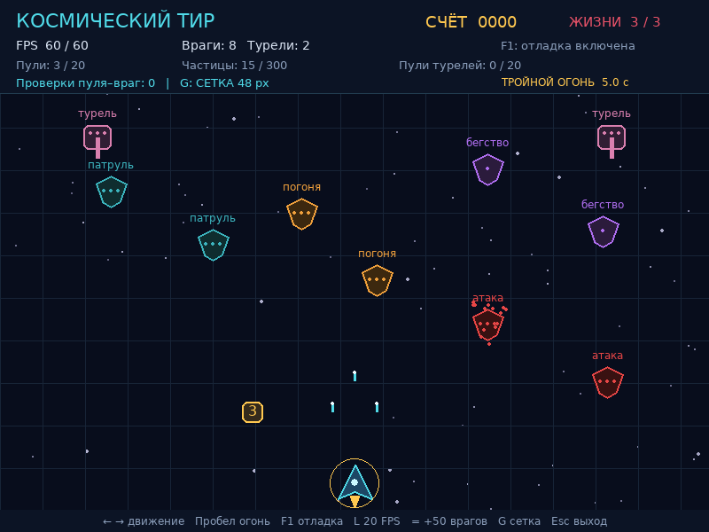

# Космический тир: паттерны игрового программирования

Практическая работа №3 по лекции 8. Python 3.10+ и pygame-ce.

Реализованы все пять этапов и четыре задания со звёздочкой:

- Delta time, пулы пуль и частиц.
- Состояния врагов: Patrol, Chase, Attack, Flee.
- Пространственная сетка 48×48 с переключением на полный перебор.
- Очередь событий и турели из компонентов Health и Shooter.
- Бонус тройного выстрела на 5 секунд, жизни игрока и экран окончания игры.



На изображении враги заранее размещены для демонстрации всех состояний.

## Запуск

```bash
python -m pip install -r requirements.txt
python main.py
```

На Windows можно использовать `py -3`, на Linux/macOS — `python3`.
Подробная инструкция, включая виртуальное окружение: [README.txt](README.txt).

## Управление

| Клавиша | Действие |
| --- | --- |
| ← / → | Движение |
| Пробел | Стрельба |
| F1 | Состояния и сетка |
| L | Ограничение 60 / 20 FPS |
| = / + | Добавить 50 врагов |
| G | Сетка / полный перебор |
| R | Новая игра после окончания |
| Esc | Выход |

## Проверка

```bash
python -m unittest discover -v
python benchmark.py
```

35 автоматических тестов. На контрольной сцене из 158 врагов и 40 пуль
сетка сокращает точные проверки с 3160 до 221, сохраняя результат попаданий.
Сохранённые результаты: [тесты](docs/tests.txt), [замеры](docs/benchmark.json).
Замеры времени отрисовки в памяти не являются измерением реального FPS.

## Отчёт

- [PDF](docs/Отчёт_Космический_тир.pdf)
- [Word](docs/Отчёт_Космический_тир.docx)

Исходная заготовка из пяти файлов не была приложена: проект самостоятельно
реализован по двум предоставленным PDF с сохранением названий основных модулей.
